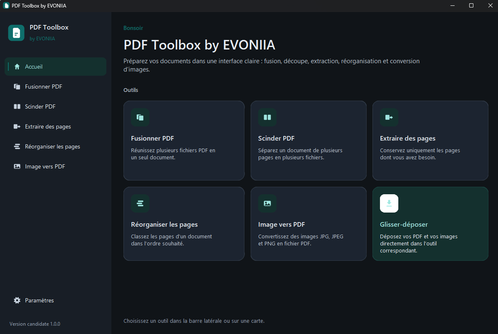

# PDF Toolbox by EVONIIA

PDF Toolbox by EVONIIA est un logiciel de bureau pour préparer des documents PDF. L'interface est en français.

La version en cours est la **candidate 1.0.0**. Elle n'est pas encore la publication définitive. Le logiciel est propriétaire et appartient à EVONIIA.

## Fonctionnalités

- Accueil et navigation entre les outils.
- Mode jour et mode nuit, conservés après la fermeture.
- Fusion de plusieurs PDF, dans l'ordre affiché.
- Découpe : une page par fichier, groupes, plages ou sélection visuelle.
- Extraction des pages choisies.
- Réorganisation visuelle des pages.
- Conversion d'images JPG, JPEG et PNG en PDF, avec format de page et marges.
- Glisser-déposer, ou sélection par le bouton Parcourir.
- Paramètres, réseaux officiels et fenêtre À propos.

Les fichiers d'origine ne sont pas modifiés. Un enregistrement qui remplacerait un fichier existant demande une confirmation, ou choisit un autre nom lors d'une découpe.

## Captures d'écran



## Prérequis

- Windows 11.
- Aucune installation de Python n'est nécessaire pour utiliser un exécutable déjà fourni par EVONIIA.

## Téléchargement

Deux formats sont prévus. Ils ne constituent pas encore une publication définitive.

- **Dossier portable.** Un dossier `PDFToolbox` à copier en entier, y compris le sous-dossier `_internal`, puis lancé par `PDFToolbox.exe`.
- **Exécutable unique.** Un fichier `PDFToolbox.exe`, à lancer seul.

Le canal prévu est une publication officielle d'EVONIIA, associée au compte GitHub [EVONIIA](https://github.com/EVONIIA). Tant que cette publication n'est pas en ligne, les fichiers présents sur un ordinateur de développement ne sont pas un canal de redistribution.

L'utilisation de l'exécutable est décrite dans le projet [EULA.txt](EULA.txt).

## Liens officiels

- GitHub : [https://github.com/EVONIIA](https://github.com/EVONIIA)
- X : [https://x.com/ApexEvoniia](https://x.com/ApexEvoniia)
- Discord : [https://discord.gg/Q5MbyF28j](https://discord.gg/Q5MbyF28j)

## Licence

PDF Toolbox by EVONIIA est un logiciel propriétaire. La consultation d'un dépôt public et la fonction de fork de GitHub ne constituent pas une licence open source.

Les conditions de propriété sont dans [LICENSE](LICENSE). Le projet de conditions d'utilisation est dans [EULA.txt](EULA.txt). Les contributions sont décrites dans [CONTRIBUTING.md](CONTRIBUTING.md).

## Crédits et licences tierces

Le logiciel, son interface et son identité appartiennent à EVONIIA.

Les bibliothèques tierces restent la propriété de leurs titulaires et soumises à leurs licences. Elles sont listées dans [LICENSES.md](LICENSES.md). PyMuPDF n'est pas utilisé. Les miniatures passent par pypdfium2.

Les signes Discord, X et GitHub, lorsqu'ils sont affichés pour rejoindre les comptes officiels, restent la propriété de leurs titulaires.

## Développement

Cette partie sert à maintenir le projet. Elle ne donne pas de droit supplémentaire sur le logiciel.

Python 3.11 ou une version plus récente est nécessaire pour lancer le code source. Le projet a été vérifié avec Python 3.13.

```powershell
py -3.13 -m venv .venv
.\.venv\Scripts\python.exe -m pip install -r requirements.txt
.\.venv\Scripts\python.exe main.py
.\.venv\Scripts\python.exe -m unittest discover -s tests -v
```

Le numéro de version est défini dans `pdf_toolbox/__init__.py`. Le statut candidat est dans `pdf_toolbox/config.py`.

Les deux exécutables se construisent avec `pdf_toolbox.spec`, en choisissant `PDFTOOLBOX_BUILD=onedir` ou `PDFTOOLBOX_BUILD=onefile`. Les dossiers `build` et `dist` restent locaux.
